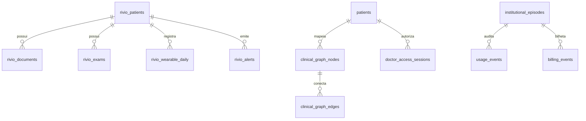

# Rivio Flow — Hub de Saúde Pessoal & Cockpit Clínico Inteligente

Plataforma unificada de inteligência em saúde que conecta o histórico pessoal do paciente — desde laudos antigos em papel até séries temporais de wearables em tempo real — estruturando o contexto clínico em uma arquitetura **Hybrid GraphRAG + Time-Series + pgvector HNSW**, com consentimento ativo e observabilidade de ponta a ponta (*Open Health Protocol* / LGPD).

---

## 🧭 Visão Geral da Solução

O **Rivio Flow** resolve a fragmentação do histórico de saúde através de duas superfícies sincronizadas em tempo real via **Supabase (PostgreSQL + pgvector + Storage + Realtime)**:

1. **App do Paciente (`./mobile`) — React Native / Expo:**
   - Interface minimalista e de alta conversão sem textos desnecessários.
   - **Tirar Foto do Exame:** Câmera integrada com IA multimodal para extração, validação e estruturação automática de biomarcadores laboratoriais.
   - **Upload de Laudo:** Ingestão de arquivos PDF ou imagens salvas no dispositivo, persistidas diretamente no bucket `clinical-documents`.
   - **Puxar Dados dos Wearables:** Sincronização direta com Apple Watch, Samsung Health e Garmin (frequência cardíaca, HRV e fases de sono).
   - **Token de Acesso Médico:** Botão primário de destaque e popup modal com código temporário de 6 dígitos, tempo de expiração regressivo (TTL) e toggles granulares de consentimento (Exames, Wearables e Alertas).

2. **Cockpit Clínico e Portal Web (`./web`) — Next.js 15 (App Router) + Tailwind CSS:**
   - **Espaço Médico (Assistencial Clínico):**
     - Autenticação e desbloqueio imediato do prontuário via Token de 6 dígitos.
     - *Briefing IA Pré-Consulta:* Síntese executiva fundamentada por GraphRAG com citações auditáveis das fontes primárias.
     - *Grafo Clínico Interativo:* Mapeamento visual das relações causais entre sintomas, exames alterados, medicamentos e anomalias fisiológicas.
     - *Evolução Longitudinal:* Séries temporais de biomarcadores sobrepostas a faixas de referência e início de medicações.
     - *Cofre de Laudos Originais:* Visualizador e download dos PDFs originais auditados.
   - **Espaço Equipe (Operações Institucionais & Governança B2B):**
     - *Observabilidade de Transições:* Registro imutável de acessos e decisões de escopo sem vazamento de dados de saúde do paciente (Zero PHI Leak).
     - *Ciclo de Vida de Episódio Institucional:* Protocolo `prepareContext` -> `readContext` -> `confirmReceipt` com TTL estrito de 15 minutos e bilhetagem idempotente (R$ 0,00 para leituras cacheadas, máximo de 1 cobrança por ciclo).
     - *Governança de Conectores:* Painel em tempo real de integridade das fontes (`connected`, `stale`, `disconnected`).

---

## ⚙️ Variáveis de Ambiente (`.env` / `.env.local`)

Tanto a aplicação Web quanto a Mobile utilizam o Supabase como camada única de persistência relacional, vetorial e de arquivos.

### 1. Configuração do Web (`./web/.env.local`)

Crie o arquivo `web/.env.local` (ou copie de `web/.env.example`):

```bash
# =============================================================================
# SUPABASE — CONEXÃO COM O BANCO DE DADOS, STORAGE E REALTIME
# =============================================================================

# URL pública do projeto Supabase (encontrada no painel em Project Settings > API)
NEXT_PUBLIC_SUPABASE_URL=https://sua-instancia.supabase.co

# Chave pública anônima (anon/public key) usada no frontend para queries com RLS
NEXT_PUBLIC_SUPABASE_ANON_KEY=eyJhbGciOiJIUzI1NiIsInR5cCI6IkpXVCJ9...

# Chave mestra administrativa (service_role key) — OBRIGATÓRIA para:
# - Rodar scripts de migração e sincronização de dados (sync-database.mjs)
# - Executar operações do Espaço Equipe e gravação imutável de transições
SUPABASE_SERVICE_ROLE_KEY=eyJhbGciOiJIUzI1NiIsInR5cCI6IkpXVCJ9...

# =============================================================================
# MOTORES DE INTELIGÊNCIA ARTIFICIAL E GRAPHRAG (OPCIONAL / FALLBACK)
# =============================================================================

# Chave da OpenAI para geração de embeddings vetoriais ou modelos complementares
OPENAI_API_KEY=sk-proj-...

# Chave da Google Gemini API para extração multimodal de PDFs e fotos de exames
GEMINI_API_KEY=AIzaSy...

# Porta de execução local do servidor Next.js (padrão: 3000)
PORT=3000
NODE_ENV=development
```

### 2. Configuração do Mobile (`./mobile/.env`)

Crie o arquivo `mobile/.env` com as chaves públicas do Supabase:

```bash
EXPO_PUBLIC_SUPABASE_URL=https://sua-instancia.supabase.co
EXPO_PUBLIC_SUPABASE_ANON_KEY=eyJhbGciOiJIUzI1NiIsInR5cCI6IkpXVCJ9...
```

---

## 🗄️ Arquitetura do Banco de Dados (Supabase)

O banco de dados é 100% unificado, garantindo sincronização bidirecional entre o **cofre pessoal** e o **grafo clínico**:



### Principais Tabelas e Índices:
- **`patients` / `rivio_patients`:** Cadastro unificado de pacientes com indexação dinâmica por CPF ou ID (`usr-marcos-2026`, `usr-camila-2026`, `usr-antonio-2026`, `usr-rafael-2026`, `usr-dan-2026`).
- **`clinical_graph_nodes` & `clinical_graph_edges`:** Nós e arestas do Grafo de Conhecimento Clínico conectando biomarcadores, sintomas e medicamentos.
- **`biomarkers`:** 23 biomarcadores canônicos indexados com embeddings de 384 dimensões normalizadas via índice **HNSW (`vector_cosine_ops`)** para padronização semântica instantânea de termos médicos.
- **`doctor_access_sessions`:** Sessões ativas de compartilhamento por token de 6 dígitos com escopos granulares e assinatura Realtime.
- **`transition_events` & `institutional_episodes`:** Camada de observabilidade institucional com residência híbrida e TTL estrito de 15 minutos.
- **Bucket `clinical-documents`:** Storage configurado com políticas públicas de leitura, contendo 39 laudos laboratoriais em formato PDF 1.4 servidos sob demanda.

---

## 🚀 Como Executar o Projeto Localmente

### Pré-requisitos
- **Node.js:** Versão 20.x ou superior recomendada.
- **Gerenciador de Pacotes:** `npm` (versão 10+).
- **Expo Go (Opcional):** Instalado no smartphone físico para escanear o QR Code do app móvel.

---

### Passo 1: Clonar o Repositório
```bash
git clone https://github.com/cdovaz/hackathon-lepoli-monashees.git
cd hackathon-lepoli-monashees
```

---

### Passo 2: Sincronizar o Banco de Dados (Supabase)
Para aplicar as migrações, criar os buckets de laudos laboratoriais e carregar os 5 pacientes de demonstração com embeddings HNSW:

```bash
cd web
npm install
node scripts/sync-database.mjs
```

---

### Passo 3: Executar a Aplicação Web (Cockpit do Médico & Equipe)
```bash
cd web
npm install
npm run dev
```
Abra o navegador em `http://localhost:3000`.
- Você terá acesso ao **Espaço Médico** e ao **Espaço Equipe** alternáveis diretamente pela barra de navegação superior ou lateral.

---

### Passo 4: Executar a Aplicação Mobile (App do Paciente)
```bash
cd mobile
npm install
npx expo start
```
- Pressione `w` no terminal para rodar na versão Web do Expo ou escaneie o QR Code com o aplicativo Expo Go (iOS/Android).

---

## 🧪 Testes e Validação de Qualidade

A solução possui pipeline rigoroso com **100% dos testes unitários e de integração passando**:

```bash
# Verificação estática de tipos no Web
cd web
npm run typecheck

# Linter de código no Web
npm run lint

# Executar a suíte de testes (255 testes automatizados)
npm test -- --run

# Verificação estática de tipos no Mobile
cd mobile
npx tsc --noEmit
```

### Resultados da Suíte:
- **255/255 testes passando** em 18 suítes de teste (Vitest).
- Validação total de Schemas AJV, integridade de snapshots dos 5 pacientes, isolamento de PHI e ciclo de residência de 15 minutos com bilhetagem idempotente.
- **0 erros de tipagem** em TypeScript no Web e no Mobile.

---

## 🎨 Design System Oficial Rivio Flow

A interface reflete estritamente os tokens de design extraídos do site `rivio.com.br` e frame Figma *Rivio Home v10* (1440 × 816):
- **Paleta de Cores:**
  - `Dark-01 (#181B1F)`: Superfície de contraste, rail lateral e palco de CTA.
  - `Light-01 (#F7F9FF)`: Fundo principal da aplicação.
  - `Brand Blue (#2563EB / #6694FF)`: Acentos, links, foco e botões primários.
  - `Brand Purple (#7E22CE / #E992FF)`: Identificadores de IA e pulso da marca.
  - `Superfície (#F0F5FF)` e `Superfície Alta (#E2EBFF)`: Molduras de KPIs e badges.
- **Acessibilidade:** Padrão **WCAG AAA** com taxas de contraste superiores a 7:1 em todos os elementos de texto e cards interativos.
- **Tipografia:** Famílias *Funnel Display* (corpo e títulos) e *Bai Jamjuree* (labels em caixa alta com tracking de 0.04em).

---

## 📄 Licença
Desenvolvido para o Desafio Rivio no Hackathon Gama House / Monashees. Todos os direitos reservados.
