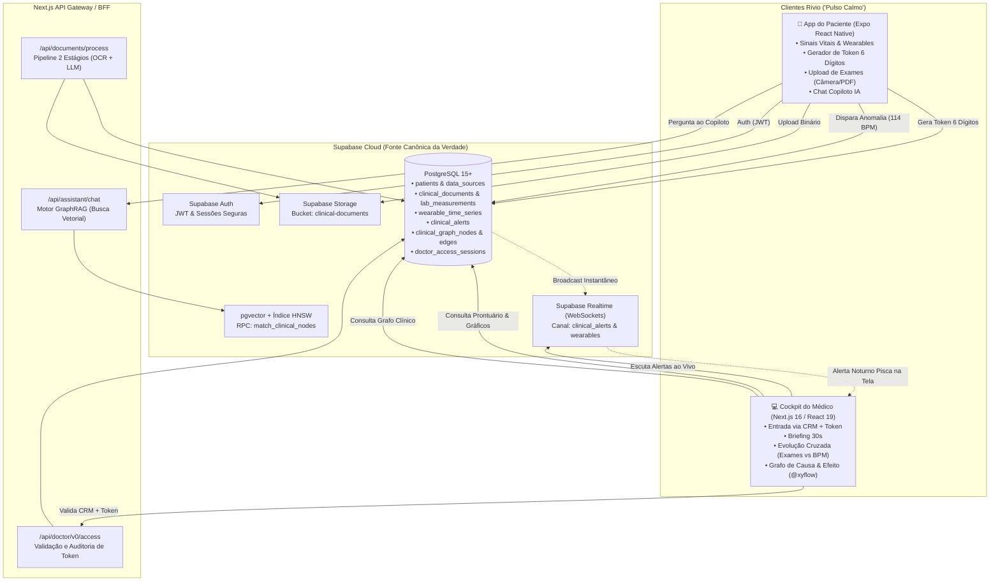
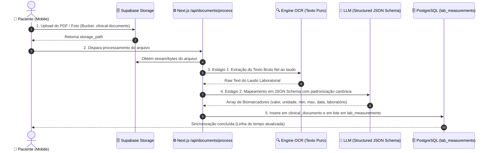
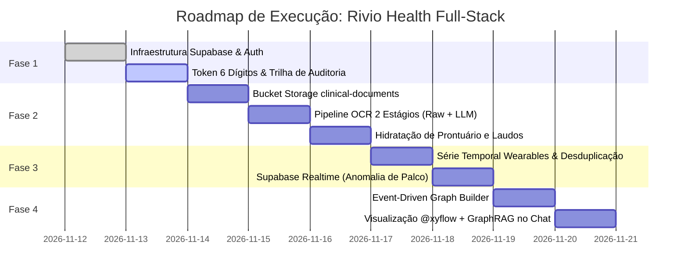

# Arquitetura do Sistema Rivio Health — "Pulso Calmo"

> Especificação arquitetural completa do Hub de Saúde Pessoal (App do Paciente + Cockpit do Médico + Supabase + Pipeline de IA).  
> Aprovada via `/grill-me` em 12/11/2026.

---

## 1. Visão Geral da Topologia do Sistema

O sistema opera sob uma topologia **BFF Híbrida (Backend-for-Frontend)** centrada no **Supabase** como fonte da verdade clínica obrigatória (*Live Only*), complementada por rotas de API especializadas no Next.js para orquestração de Inteligência Artificial, processamento em 2 estágios de documentos e auditoria de consentimento médico.

---

## 2. Subsistemas e Contratos de Dados

### 2.1 Protocolo de Consentimento Médico e Token Efêmero (Open Health)
1. **Geração no Mobile**: O paciente gera um token alfanumérico seguro de 6 dígitos (ex: `RV-8492` ou `R9K42X`) com TTL de 15 minutos.
2. **Persistência**: Gravado em `doctor_access_sessions` com `active = true`, `expires_at = NOW() + INTERVAL '15 min'` e escopo `['read_exams', 'read_wearables', 'read_graphrag_briefing']`.
3. **Validação no Web**: O médico preenche CRM + Estado + Nome e digita o token. A API valida:
   - Token existe, `active = true` e `expires_at > NOW()`.
   - Se aprovado, grava `doctor_crm` e `doctor_name` na sessão, emitindo credencial efêmera.
4. **Trilha de Auditoria & Revogação**:
   - O paciente vê no Mobile o log de quem acessou seu prontuário em tempo real.
   - O paciente pode revogar com 1 toque no app (`active = false`, `revoked_at = NOW()`).
   - Ao revogar ou expirar, o Web invalida imediatamente todo o cache clínico em memória.

---

### 2.2 Pipeline Documental em 2 Estágios (OCR Textual + Parser LLM)

---

### 2.3 Sinais Contínuos de Wearables e Realtime de Alta Fidelidade

- **Tabela**: `wearable_time_series` com restrição de idempotência e desduplicação `UNIQUE(patient_id, metric_type, recorded_at, source_device)`.
- **Métricas**: `heart_rate`, `hrv`, `spo2`, `sleep_deep`, `sleep_rem`, `sleep_score`.
- **Simulador de Palco**:
  - Quando o apresentador clica em *"Disparar Taquicardia Noturna (114 BPM)"* no Mobile:
  - 1. Insere a anomalia em `wearable_time_series` e o alerta em `clinical_alerts` (`category: wearable_anomaly`, `severity: critical`).
  - 2. O canal do Supabase Realtime dispara evento WebSocket para o Cockpit do Médico (`Web`).
  - 3. O painel médico atualiza a curva de BPM noturna instantaneamente, sem recarregar a página, destacando a correlação com a Ferritina Sérica de 22 ng/mL.

---

### 2.4 Knowledge Graph Dirigido por Eventos & Copiloto GraphRAG

- **Nós e Arestas Canônicas**:
  - Tabelas: `clinical_graph_nodes` e `clinical_graph_edges`.
  - Tipos de nós: `patient`, `biomarker`, `lab_result`, `symptom`, `medication`, `condition`, `wearable_alert`.
  - Arestas: `MEDIU`, `TOMA`, `CORRELACIONADO_COM`, `APRESENTA`, `INDICA`.
- **Busca Semântica**:
  - Cada nó possui vetor `embedding vector(384)` indexado via **HNSW**.
  - Função RPC `match_clinical_nodes(query_embedding, patient_id)` recupera os nós mais relevantes com similaridade de cosseno em milissegundos.
  - O Chat do Mobile e o Briefing do Médico citam exatamente as fontes e evidências encontradas no grafo.

---

## 3. Roadmap das 4 Fases de Implementação

### Detalhamento das 4 Fases:

#### **Fase 1: Infraestrutura de Conexão, Auth & Token Efêmero (Open Health Protocol)**
- Configurar credenciais do Supabase no Mobile e Web.
- Conectar a geração do token de 6 dígitos no Mobile (`ShareScreen.tsx`) diretamente à tabela `doctor_access_sessions`.
- Conectar a validação do token no Web (`Entry.tsx` / `/doctor/consultation`) com auditoria de CRM e expiração.
- Painel de auditoria no Mobile para o paciente ver acessos ativos e histórico.

#### **Fase 2: Prontuário Central, Storage & Pipeline Documental em 2 Estágios**
- Configuração do bucket `clinical-documents` no Supabase Storage com RLS.
- Criação do endpoint `/api/documents/process` executando: Estágio 1 (OCR de texto puro) + Estágio 2 (Parser JSON padronizado com `biomarkers`).
- Inserção em `clinical_documents` e `lab_measurements`.
- Conectar gráficos de biomarcadores (`BiomarkerChart` no mobile e `Evolution` no web) para ler dados reais do Supabase.

#### **Fase 3: Sinais Vitais Contínuos (Wearables) & Sincronização Realtime**
- Persistência das séries de Apple Watch em `wearable_time_series`.
- Ativação do Supabase Realtime no Web (`supabase.channel('public:clinical_alerts')`).
- Disparo da simulação de anomalia no Mobile atualizando o Cockpit Médico instantaneamente via WebSocket.

#### **Fase 4: Knowledge Graph Dirigido por Eventos & Copiloto GraphRAG**
- Serviço Event-Driven que sincroniza nós e arestas de causa/efeito a cada novo laudo ou anomalia.
- Renderização do grafo no Web via `@xyflow/react` lendo do Supabase.
- Rota `/api/assistant/chat` executando a RPC `match_clinical_nodes` com embeddings HNSW para o copiloto no Mobile com fontes clínicas citadas.
